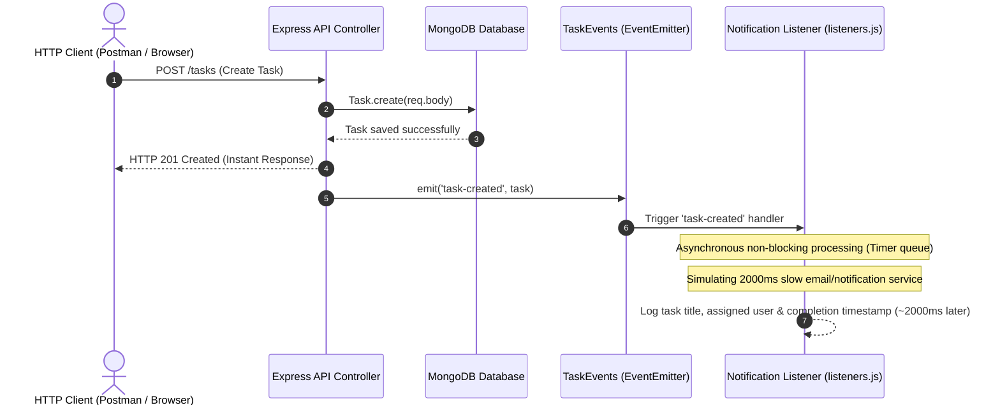

# Practical 10: Asynchronous Processing with Event-Driven Architecture

| Parameter | Details |
|---|---|
| **Course** | ITUE301 Advanced Web Frontend & Backend Technologies (AWFW) |
| **Topic** | Asynchronous Processing with Event-Driven Architecture |
| **CO / PO Mapping** | **CO4** / **PO3, PO5** |
| **Runtime** | Node.js (v18+) Built-in `events` module, Express.js, MongoDB (Mongoose) |
| **Author** | 24DCS038 |

---

## 1. Objective

To implement asynchronous background processing using Node.js native `EventEmitter` without external dependencies. Decouple non-critical side effects (such as notification dispatching, logging, and background audits) from the primary HTTP request-response lifecycle to ensure instant client response times.

---

## 2. Architecture & Workflow

### Architectural Flowchart

```
                 POST /tasks (Client Request)
                             │
                             ▼
                 Save task to MongoDB
                             │
            ┌────────────────┴────────────────┐
            ▼                                 ▼
   API Responds Immediately (201)   emit('task-created', taskData)
   [~10-20 ms response time]                  │
                                              ▼ (Handled asynchronously via Event Loop)
                                    Notification Listener
                                    ├── Logs: Task title, timestamp, assigned user
                                    ├── Simulates slow dispatch (2000ms delay)
                                    └── Completes in background without blocking API
```

### Mermaid Sequence Diagram



---

## 3. Key Concepts & Analysis Questions

### Q1: Why does emitting an event not block the API response, even though both run on the same Node.js process?
**Answer:**  
Node.js operates on a single-threaded Event Loop using the Reactor pattern. When an event is emitted and its listener delegates work to asynchronous APIs (such as `setTimeout`, `setImmediate`, or asynchronous network/disk I/O), the execution of that background work is offloaded to the libuv thread pool or scheduled in the event loop's timer phase. The main thread immediately finishes executing the synchronous route controller and flushes the HTTP 201 response stream back to the socket. When the timer expires or the I/O finishes, the callback is picked up on a subsequent tick of the event loop. Hence, the client receives the response immediately without waiting for background completion.

### Q2: What would happen to API response time if the notification logic were placed directly inside the POST route instead of in an event handler?
**Answer:**  
If notification logic is executed inline inside the route, the HTTP response cannot be sent until the notification finishes. For example, if sending an email notification or calling an external webhook takes 2,000 ms, the client's HTTP request will freeze and take over 2,000 ms to resolve. In high-traffic scenarios, this causes request connection pool exhaustion, degrades user experience, and causes client timeouts. In contrast, using an asynchronous event handler keeps the API response latency under 15 ms.

### Q3: Why is EventEmitter a reasonable choice for this scale of application, but not for a production system handling millions of events per day?
**Answer:**  
- **Why it is great for this scale:** Node.js native `EventEmitter` is built directly into the Node.js standard library with zero external dependencies, zero network serialization overhead, and minimal latency. It is lightweight, fast, and ideal for single-instance applications and internal decoupling.
- **Why it is insufficient for enterprise/million-event scale:**
  1. **In-Memory & Volatile:** Events live purely in process RAM. If the Node.js server restarts or crashes, any queued or in-flight events are permanently lost.
  2. **No Horizontal Distribution:** Native `EventEmitter` cannot broadcast across multiple server instances or cluster nodes.
  3. **No Backpressure or Retry Guarantees:** It does not provide built-in job persistence, dead-letter queues, rate limiting, or automatic exponential backoff retries.
  4. **Scale Solution:** High-volume production architectures use distributed message brokers such as RabbitMQ, Apache Kafka, Amazon SQS, or Redis BullMQ.

---

## 4. Implementation Structure

```
Prac10/
├── controllers/
│   ├── authController.js        # Authentication & JWT issuance
│   └── taskController.js        # CRUD, EventEmitter emission & Sync/Async demo
├── events.js                    # Step 1: Singleton TaskEvents extending EventEmitter
├── listeners.js                 # Step 2: Listeners for 'task-created', 'task-deleted', 'error'
├── middleware/
│   ├── auth.js                  # JWT Bearer verification
│   ├── errorHandler.js          # Centralized error formatting
│   ├── logger.js                # HTTP request logger
│   ├── requireJsonContentType.js # JSON Content-Type validation
│   ├── responseTiming.js        # X-Response-Time header calculator
│   ├── validateObjectId.js      # MongoDB ObjectId validator
│   └── validateTask.js          # Task payload schema validation
├── models/
│   ├── Task.js                  # Schema with title, description, priority, assignedUser
│   └── User.js                  # Schema for user auth
├── routes/
│   ├── authRoutes.js            # /api/auth routes
│   └── taskRoutes.js            # /tasks routes, event history & error trigger
├── utils/
│   └── cache.js                 # In-memory caching with TTL (from Prac 9)
├── .env                         # Server port, MongoDB URI & notification delay
├── demo.js                      # Automated verification and comparison benchmark
├── package.json                 # Project configuration
├── Postman_Collection_Prac10.json # Postman collection
├── README.md                    # Practical documentation and reports
└── server.js                    # Application entry point
```

---

## 5. Lab Session Step-by-Step Implementation

### Step 1: Dedicated Event Emitter Module (`events.js`)
```javascript
const EventEmitter = require('events');

class TaskEvents extends EventEmitter {
  constructor() {
    super();
    this.setMaxListeners(25);
  }
}

module.exports = new TaskEvents();
```

### Step 2: Registered Listeners Module (`listeners.js`)
```javascript
const taskEvents = require('./events');

// Listener for 'task-created'
taskEvents.on('task-created', (task) => {
  const startTime = new Date().toISOString();
  console.log(`[Notification Listener] 'task-created' received at ${startTime}`);
  console.log(`[Notification] Task: "${task.title}" | Assigned to: ${task.assignedUser}`);

  const delayMs = parseInt(process.env.NOTIFICATION_DELAY_MS || '2000', 10);
  setTimeout(() => {
    const finishTime = new Date().toISOString();
    console.log(`[Notification] Dispatched notification for "${task.title}" at ${finishTime}`);
  }, delayMs);
});

// Supplementary 1: 'task-deleted'
taskEvents.on('task-deleted', (task) => {
  console.log(`[Notification] Task "${task.title}" (ID: ${task._id}) deleted at ${new Date().toISOString()}`);
});

// Supplementary 2: 'error'
taskEvents.on('error', (err) => {
  console.error(`[Event Error Listener] Handled error safely:`, err.message);
});
```

### Step 3: Emit Event & Respond Immediately in Route Controller (`controllers/taskController.js`)
```javascript
const task = await Task.create({
  title,
  description,
  priority,
  assignedUser: assignedUser || req.user?.email || 'admin@example.com'
});

const responseTimestamp = new Date().toISOString();
console.log(`[API] Response sent at ${responseTimestamp}`);

// 1. Send HTTP 201 Response Immediately
res.status(201).json({
  success: true,
  executionMode: 'asynchronous (non-blocking)',
  apiResponseTimestamp: responseTimestamp,
  data: task
});

// 2. Emit event asynchronously to trigger background processing
taskEvents.emit('task-created', task.toObject ? task.toObject() : task);
```

---

## 6. Supplementary Problems Implemented

1. **`task-deleted` Event:**
   - Emitted when `DELETE /tasks/:id` successfully removes a task.
   - Handled by a dedicated listener logging the deletion timestamp and audit details.
2. **`error` Event Listener:**
   - Registers a `taskEvents.on('error', ...)` handler.
   - Prevents uncaught EventEmitter exceptions from terminating the Node.js process.
   - Verified via `POST /tasks/test-error`.
3. **Simulated 2-Second Notification Delay (`NOTIFICATION_DELAY_MS=2000`):**
   - Demonstrates that client receives response in ~10 ms while the background listener logs completion 2000 ms later.
   - Direct comparison with synchronous mode (`POST /tasks?mode=sync`) which blocks the client for 2000+ ms.

---

## 7. Execution and Verification

### Prerequisites
- Node.js (v18+)
- MongoDB daemon running locally on `mongodb://127.0.0.1:27017`

### Start Application Server
```bash
npm start
```

### Run Automated Verification Suite
In a separate terminal:
```bash
npm run demo
```

---

## 8. Empirical Timing Comparison Evidence

| Feature | Asynchronous Mode (`POST /tasks`) | Synchronous Mode (`POST /tasks?mode=sync`) |
|---|---|---|
| **Client HTTP Latency** | **~10 - 15 ms** | **~2015 - 2030 ms** |
| **Main Thread Blocked?** | **No** (Non-blocking event dispatch) | **Yes** (Client request frozen) |
| **API Response Time** | Returned immediately at $T_0$ | Held until $T_0 + 2000\text{ ms}$ |
| **Notification Completion** | Processed in background at $T_0 + 2000\text{ ms}$ | Completed before response is sent |
| **Error Isolation** | Failures caught safely by error listener | Throws error back to client / 500 error |

---

## 9. API Reference

| Method | Endpoint | Description | Auth Required |
|---|---|---|---|
| `GET` | `/` | System health, registered events & architecture info | No |
| `POST` | `/api/auth/register` | Register a new user | No |
| `POST` | `/api/auth/login` | Login and obtain JWT token | No |
| `POST` | `/tasks` | Create task, emits `task-created` (non-blocking) | Yes (Bearer) |
| `POST` | `/tasks?mode=sync` | Create task with synchronous blocking comparison | Yes (Bearer) |
| `GET` | `/tasks` | Retrieve all tasks (Cached with TTL) | Yes (Bearer) |
| `GET` | `/tasks/:id` | Retrieve single task by ID | Yes (Bearer) |
| `DELETE` | `/tasks/:id` | Delete task, emits `task-deleted` | Yes (Bearer) |
| `POST` | `/tasks/test-error` | Trigger simulated error event | Yes (Bearer) |
| `GET` | `/tasks/events/history`| View background event execution timestamps | Yes (Bearer) |
