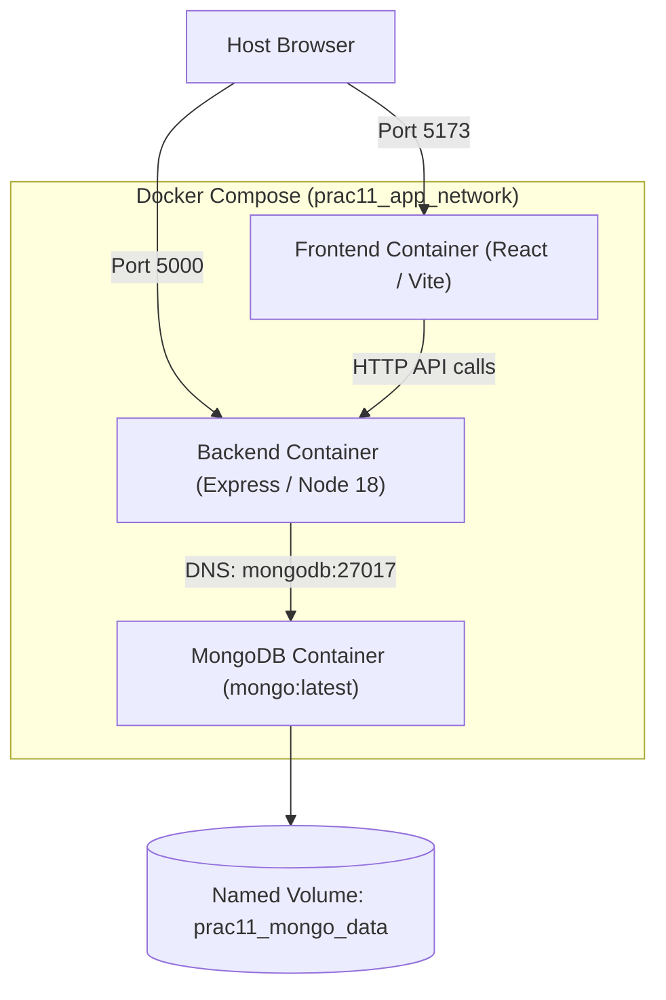

# Practical 11: Containerization with Docker and Docker Compose

| Parameter | Details |
|---|---|
| **Course** | ITUE301 Advanced Web Development Frameworks (AWFW) |
| **Topic** | Containerization with Docker and Docker Compose |
| **CO / PO Mapping** | **CO5** / **PO3, PO5** |
| **Runtime** | Docker Desktop / Docker Engine, Docker Compose (v2+), Node 18, MongoDB |
| **Author** | 24DCS038 |

---

## 1. Objective

To containerize the complete full-stack Task Management application (React Frontend, Node/Express Backend, and MongoDB Database) using Docker and orchestrate all multi-container services seamlessly using Docker Compose with a single-command workflow (`docker-compose up`).

---

## 2. Architecture & Container Orchestration

### Multi-Container Network Topology

```
                  Host Browser (localhost:5173 / localhost:5000)
                                    │
                                    ▼
       ┌─────────────────────────────────────────────────────────────┐
       │             Bridge Network: prac11_app_network              │
       │                                                             │
       │   ┌────────────────┐       ┌────────────────┐               │
       │   │ prac11-frontend│       │ prac11-backend │               │
       │   │  (Port 5173)   │──────►│  (Port 5000)   │               │
       │   └────────────────┘       └───────┬────────┘               │
       │                                    │                        │
       │                       DNS: mongodb │                        │
       │                                    ▼                        │
       │                            ┌────────────────┐               │
       │                            │ prac11-mongodb │               │
       │                            │  (Port 27017)  │               │
       │                            └───────┬────────┘               │
       │                                    │                        │
       └────────────────────────────────────┼────────────────────────┘
                                            ▼
                           Named Volume: prac11_mongo_data
```

### Mermaid Architecture Diagram



---

## 3. Key Concepts & Analysis Questions

### Q1: Why does the backend container need to reference the MongoDB container by its service name (e.g., `mongodb`) rather than `localhost`?
**Answer:**  
In Docker, each container runs inside its own isolated network namespace with its own `localhost` (loopback interface `127.0.0.1`). If the backend attempts to connect to `localhost:27017`, it is looking for MongoDB running *inside the backend container itself*, which fails with `ECONNREFUSED`. When containers join a user-defined bridge network created by Docker Compose (`app-network`), Docker provides an automatic internal DNS resolver. The service name `mongodb` declared in `docker-compose.yml` resolves dynamically to the internal IP address assigned to the MongoDB container.

### Q2: What is the difference between `EXPOSE` in a Dockerfile and the `ports` mapping in `docker-compose.yml`?
**Answer:**  
- **`EXPOSE` (Dockerfile):** Acts purely as documentation and internal metadata indicating which ports the application listens on inside the container. It does **not** publish or bind the port to the host machine.
- **`ports` (docker-compose.yml):** Actually establishes a port forward between the host machine and the container (`HOST_PORT:CONTAINER_PORT`, e.g., `"5000:5000"`). This enables external clients, Postman, or browsers running on the host OS to access the containerized service.

### Q3: Why is it considered bad practice to copy `node_modules` into a Docker image instead of running `npm install` inside the container?
**Answer:**  
1. **Binary Incompatibility:** Many npm packages (e.g., `bcryptjs`, native C++ bindings, or esbuild) compile platform-specific native binaries. Copying Windows or macOS host `node_modules` into a Linux-based Alpine/Debian container causes runtime failures (`invalid ELF header`).
2. **Build Context Bloat:** `node_modules` typically contains hundreds of megabytes of files, dramatically slowing down Docker build context transfers.
3. **Inconsistent Dependencies:** Running `npm install` inside the container guarantees that packages are cleanly built against the target container OS and architecture.

---

## 4. Supplementary Solutions Implemented

1. **Context Optimization via `.dockerignore`:**
   - Both root, backend, and frontend contain `.dockerignore` files explicitly omitting `node_modules`, `dist`, `.env`, and git history to maintain rapid image build speeds.
2. **Multi-Stage Build for React Frontend:**
   - Uses `FROM node:18-alpine AS build` for dependency installation and Vite compilation, minimizing final production image size.
3. **Persistent Named Volume for MongoDB:**
   - Declares named volume `mongo-data` mapped to `/data/db`, ensuring database records persist even when containers are stopped, removed, or rebuilt.

---

## 5. Step-by-Step Execution Guide

### 1. Build and Start All Containers
```bash
cd "f:\5Th Sem\ITUE301 AWFW\Prac11"
docker-compose up --build -d
```

### 2. Verify Running Containers
```bash
docker ps
```
*Expected Output:* Three active containers (`prac11-frontend`, `prac11-backend`, `prac11-mongodb`) with status `Up`.

### 3. Inspect Service Logs
```bash
docker-compose logs -f backend
```

### 4. Test Endpoints
- **Frontend App**: Open browser at `http://localhost:5173`
- **Backend API**: Open `http://localhost:5000`
- **Health Check**: `GET http://localhost:5000/`

### 5. Stop the Application
```bash
docker-compose down
```
*(Data in MongoDB is preserved inside `prac11_mongo_data`).*
